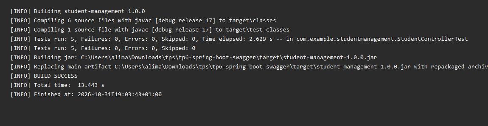
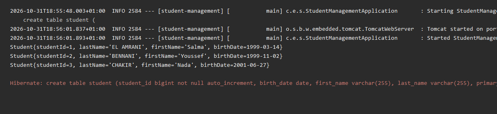
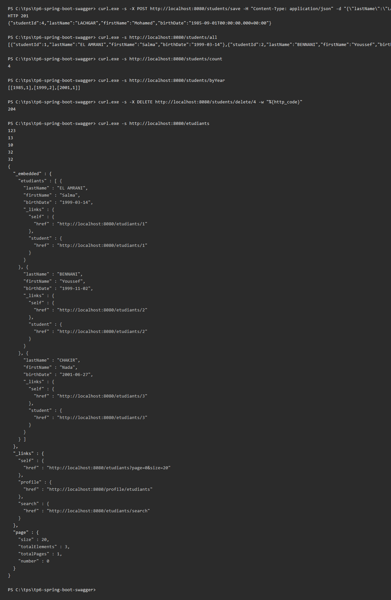
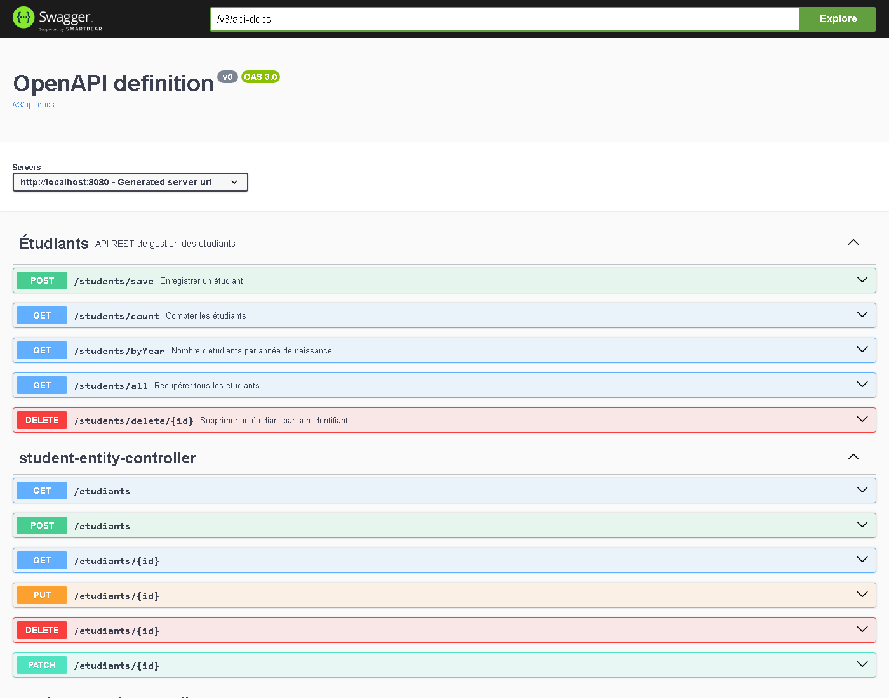
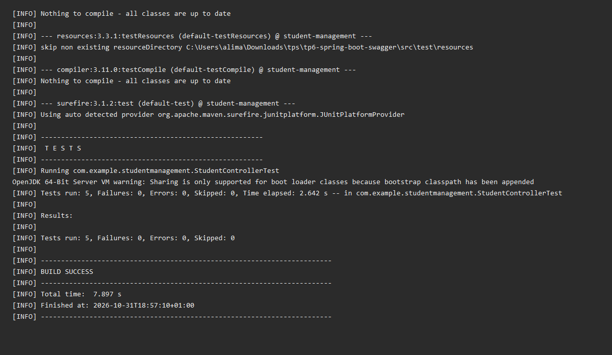

# TP 6 — Spring Boot et Swagger : documentation d'API Microservices

## Compilation du projet et exécution des tests unitaires

## Démarrage de l'application Spring Boot

## Tests des endpoints REST

## Documentation Swagger UI

## Rapport des tests unitaires (JUnit 5 + Mockito)

